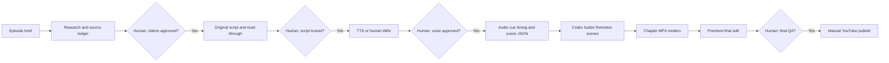

# 10 — Automation Architecture (Deliberate Hybrid)
## Why not fully autonomous publishing?
Hands-free automation risks invented facts, odd speech, repeated low-value animation and IP/license problems. Build repeatable automation with **four deliberate human approvals**.

## Flow


## Automation phases
| Phase | Automate | Do not automate |
|---|---|---|
| v0 (pilot) | File naming; manifest validation; deterministic renders; FFmpeg checks | Facts, narration casting, publication |
| v1 (after pilot) | Voice chunk export; transcript timing; visual event mapping; render queue; license manifest | Dramatic pacing, technical diagram approval |
| v2 (after 3 videos) | Reusable style/scene templates; thumbnail variations; batch QA and analytics exports | Final editorial selection, copyright review, upload approval |

## JSON shape — use as starting point, not a complete schema
```json
{
  "episodeId": "E001",
  "fps": 30,
  "width": 1920,
  "height": 1080,
  "narrationAudio": "public/audio/E001_narration.wav",
  "scenes": [
    {"id": "E001_S001", "type": "cold_open", "startFrame": 0, "durationFrames": 300, "narrationCueIds": ["N001"], "visualText": ["ONE ITEM LEFT"], "props": {"buyers": 2}, "sourceClaimIds": []}
  ]
}
```

## Suggested local pipeline commands (design, not implemented here)
- `python tools/validate_episode.py episode.json`: schema, asset presence, licensing fields, frame overlaps.
- `python tools/align_narration.py`: optional forced alignment on **owned** narration; requires separately installed model/tools.
- `npm run render:chapters -- --episode E001`: deterministic Remotion renders.
- `ffmpeg -i chapter.mp4 ...`: build preview/check codecs/audio; exact flags depend on local setup.
- `python tools/report.py`: produce chapter/scene QC report.

## Risk / dependency register
- TTS regenerate changes scene timing → lock voice before animation.
- Codex subscription limit reached → divide small tasks, save progress in Git, avoid unnecessary retries.
- Long renders → render chapters and cache expensive visual components.
- Unsupported/unlicensed stock audio → replace before final export.
- Fully automated research errors → require primary source ledger and manual verification.
- Proprietary Adobe project files → don't auto-write undocumented project binary; human edit in Premiere.
